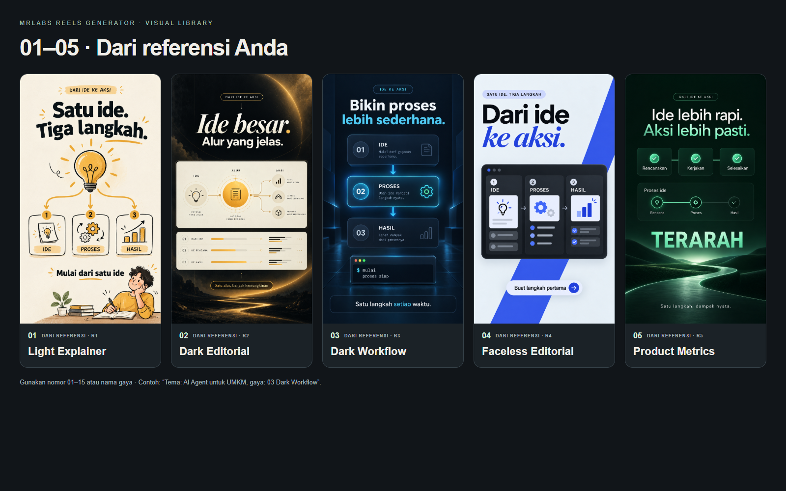
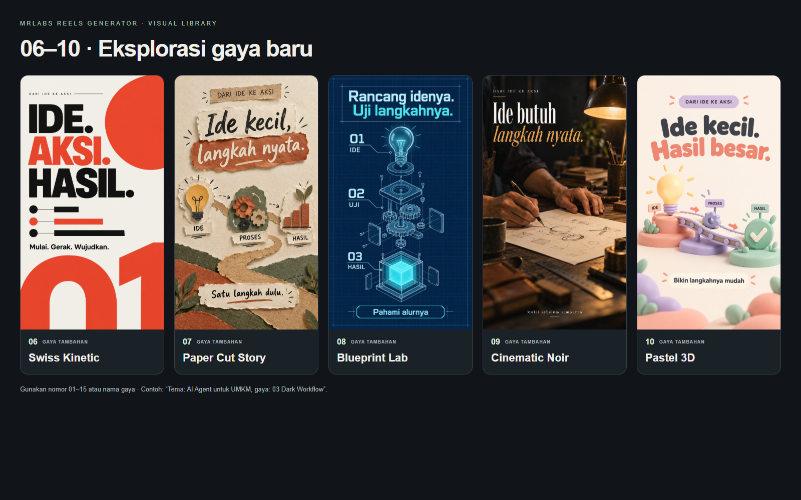
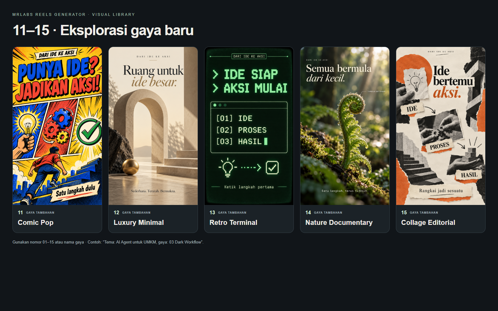

# MRLabs Reels Generator

Skill untuk **Codex** yang membantu membuat Reels dan YouTube Shorts dari sebuah tema: riset, naskah, storyboard, voice-over, B-roll, SFX, caption, lalu editing di HyperFrames.

**Naskah dan rencana adegan harus disetujui pengguna sebelum produksi media dimulai. Setiap video wajib memiliki minimal satu adegan B-roll yang relevan.**

Nama repositori adalah `mrlabs-reels-generators`, sedangkan nama skill dan perintahnya adalah **`mrlabs-reels-generator`**.

## Mulai dari sini

1. Pasang skill ini dan dependensi editing/Watch di bawah.
2. Siapkan akses Google AI Studio; siapkan Gemini/Flow untuk aset visual yang dipilih.
3. Di Codex, kirim tema dan, jika ingin, nomor gaya.
4. Tinjau naskah dan storyboard. Berikan persetujuan untuk versi yang sesuai.
5. Agent melanjutkan produksi, editing, dan pemeriksaan hasil sesuai akses alat yang tersedia.

```text
Gunakan $mrlabs-reels-generator.
Tema: bagaimana AI membantu pemilik kedai kopi mengelola stok.
Audiens: pemilik UMKM.
Durasi: sekitar 35 detik, Bahasa Indonesia.
Gaya: 04 Faceless Editorial.
Buat naskah dan storyboard dahulu untuk saya setujui.
```

Skill ini berisi instruksi, referensi, aset contoh gaya, template, dan pemeriksa persetujuan. Eksekusi membutuhkan agent dengan akses filesystem, terminal, browser, serta runtime dan akun yang diperlukan. Memasang skill saja tidak memasang semua aplikasi atau memberi akses ke layanan Google.

## Alur kerja

```text
Tema
  -> Riset dan pilihan gaya
  -> Naskah lengkap, storyboard, rencana B-roll dan SFX
  -> Persetujuan pengguna
  -> Narasi Google AI Studio TTS dan aset adegan
  -> Editing HyperFrames, caption, SFX, dan transisi
  -> Review hasil encode
  -> Video final dan proyek lokal yang dapat diedit
```

Sebelum persetujuan, agent boleh melakukan riset, menampilkan preview gaya yang sudah tersedia, dan menulis rencana. Pembuatan gambar/video/narasi, pengunduhan SFX produksi, serta render menunggu persetujuan naskah. Memilih gaya atau mengirim tema belum termasuk persetujuan terhadap naskah yang belum ditampilkan.

## Instalasi

### Pilihan 1 — minta Codex memasang skill

Salin permintaan berikut ke Codex yang memiliki `$skill-installer`:

```text
Gunakan $skill-installer untuk memasang skill dari repositori
https://github.com/MaulanaR/mrlabs-reels-generators
pada ref master, path root (.), dengan nama lokal mrlabs-reels-generator.

Periksa dependensi watch, edit-video, hyperframes, dan hyperframes-cli.
Jika belum tersedia, pasang dari sumber upstream yang disebutkan di README.
```

`SKILL.md` berada di root repositori. Cantumkan `--name mrlabs-reels-generator` jika memasang path `.` melalui skrip installer, dan cantumkan `--ref master` karena branch repositori ini adalah `master`.

### Pilihan 2 — skrip installer lokal di PowerShell

Untuk instalasi Codex yang menyediakan installer di `$CODEX_HOME/skills/.system/skill-installer/`:

```powershell
$reelsCodexRoot = if ($env:CODEX_HOME) { $env:CODEX_HOME } else { Join-Path $env:USERPROFILE '.codex' }
$reelsInstaller = Join-Path $reelsCodexRoot 'skills\.system\skill-installer\scripts\install-skill-from-github.py'

python $reelsInstaller --repo MaulanaR/mrlabs-reels-generators --ref master --path . --name mrlabs-reels-generator
```

Jika installer tidak tersedia pada lokasi tersebut, gunakan pilihan pertama dan biarkan Codex menemukan installer atau folder skill aktifnya. Installer akan menolak menimpa folder skill yang sudah ada; simpan perubahan lokal sebelum memperbarui instalasi.

Skill tersedia pada giliran berikutnya setelah berhasil dipasang. Jika belum muncul, muat ulang sesi Codex dan pastikan nama folder serta frontmatter-nya `mrlabs-reels-generator`. Lihat juga [panduan skill OpenAI](https://developers.openai.com/codex/skills).

## Dependensi

### Skill pendamping

| Dependensi | Kegunaan | Sumber |
| --- | --- | --- |
| `watch` | Membaca referensi dan meninjau video hasil | [Watch Skill](https://github.com/oxbshw/watch-skill), folder `skills/watch` |
| `edit-video` | Panduan persiapan media, sinkronisasi, dan assembly | [Herk Edit Kit](https://github.com/nateherkai/herk-edit-kit), `.agents/skills/edit-video` |
| `hyperframes` | Komposisi HTML/GSAP, caption, transisi, dan media | Herk Edit Kit, `.agents/skills/hyperframes` |
| `hyperframes-cli` | Panduan preview dan render | Herk Edit Kit, `.agents/skills/hyperframes-cli` |

Pasang skill pendamping ke folder skill yang sama bila ingin memakai tautan sibling bawaan. Instalasi melalui plugin juga dapat dipakai: agent perlu menemukan lokasi skill dan referensinya yang sebenarnya. Jika menggunakan keseluruhan pipeline Herk, ikuti panduan upstream untuk skill pendamping tambahan seperti `gsap`, `video-storytelling`, dan `hyperframes-video-beats`.

Contoh pemasangan dependensi inti dengan installer PowerShell di atas, **hanya untuk skill yang belum terpasang**:

```powershell
python $reelsInstaller --repo oxbshw/watch-skill --path skills/watch --name watch
python $reelsInstaller --repo nateherkai/herk-edit-kit --path .agents/skills/edit-video .agents/skills/hyperframes .agents/skills/hyperframes-cli
```

### Runtime lokal

Siapkan Git, Python 3.11–3.13 untuk jalur Watch yang didokumentasikan upstream, Node.js 22 atau lebih baru untuk Herk/HyperFrames, FFmpeg beserta `ffprobe`, dan browser yang didukung. Instruksi upstream tetap menjadi rujukan jika kebutuhan versi berubah.

**Watch engine:** skill `watch` dan engine CLI adalah dua komponen yang perlu disiapkan. Mengikuti [petunjuk upstream](https://github.com/oxbshw/watch-skill#readme), pemasangan dasar untuk kemampuan frame/retrieval adalah:

```sh
python -m pip install "watch-skill[standard]"
watch-skill doctor
```

Tambahan OCR atau transkripsi lokal dipasang hanya jika dibutuhkan. Untuk PC ringan, gunakan caption/transkrip yang tersedia atau timing segmen narasi; jangan memasang model Whisper besar sebagai prasyarat seluruh workflow.

**Herk Edit Kit:** clone toolkit ke direktori pilihan Anda, kemudian jalankan setup sesuai [README upstream](https://github.com/nateherkai/herk-edit-kit#install):

```sh
git clone https://github.com/nateherkai/herk-edit-kit.git
cd herk-edit-kit
npm ci
npm run setup
```

Set lokasi toolkit agar agent dapat menemukan utilitas dan referensinya. Jalankan dari direktori `herk-edit-kit` tersebut:

```powershell
$env:HERK_EDIT_KIT_ROOT = (Get-Location).Path
```

Pada macOS/Linux:

```sh
export HERK_EDIT_KIT_ROOT="$PWD"
```

Variabel di atas berlaku untuk proses/sesi terminal tersebut. Agar terlihat oleh Codex, luncurkan Codex dari lingkungan itu, atur variabel pengguna secara persisten, atau beri tahu agent lokasi toolkit di chat. Skill juga dapat menemukan checkout melalui catatan instalasi dependensi; tidak ada path drive milik pembuat yang wajib diikuti.

Perintah utilitas toolkit dijalankan dari root toolkit. Perintah komposisi HyperFrames dijalankan dari direktori `10_hyperframes/` milik proyek Reel. Ikuti setup upstream untuk memastikan runtime HyperFrames benar-benar tersedia pada direktori komposisi sebelum render.

## Akun, suara, dan aset visual

| Bagian | Jalur yang digunakan |
| --- | --- |
| Voice-over | Google AI Studio TTS melalui API atau browser yang sudah login |
| Gambar/ilustrasi | Gemini, satu aset untuk satu adegan sesuai naskah |
| B-roll bergerak | Google Flow atau footage sumber yang sesuai dan boleh digunakan |
| B-roll dari gambar | Gambar sesuai tema dengan pan/zoom/parallax saat editing |
| SFX | Mixkit sebagai sumber utama; Pixabay sebagai cadangan |
| Editing | HyperFrames/GSAP dan FFmpeg lokal |

### Google AI Studio TTS

Untuk API, sediakan `GEMINI_API_KEY` melalui environment atau secret store yang dapat diakses agent. Ikuti [panduan key Google](https://ai.google.dev/gemini-api/docs/api-key). Jangan masukkan key ke prompt, chat publik, `production.json`, atau Git. Skill tidak otomatis memuat sebuah `.env` hanya karena file itu ada.

Jika key belum tersedia, agent dapat menggunakan [Google AI Studio](https://aistudio.google.com/) melalui browser, asalkan sesi sudah login dan tool browser mendukung operasi serta pengunduhan hasil. Pengguna mungkin perlu menyelesaikan login sendiri. Tanpa key maupun akses browser yang sesuai, produksi suara berhenti sampai akses tersedia.

Narasi membacakan teks yang sudah disetujui. Arahan nada/tempo disimpan terpisah dari teks yang diucapkan. Model dan voice dipilih dari yang benar-benar tersedia saat produksi. Lihat [panduan TTS skill](references/google-ai-studio-tts.md), [dokumentasi Google](https://ai.google.dev/gemini-api/docs/speech-generation), dan [harga/akses gratis](https://ai.google.dev/gemini-api/docs/pricing).

Default suara adalah **free-only**. Agent berhenti ketika akses gratis atau kuota tidak tersedia; tidak mengaktifkan billing atau berpindah penyedia secara otomatis. Akses Gemini/Flow, model visual, dan allowance-nya mengikuti akun pengguna. Repositori ini tidak menjanjikan seluruh layanan cloud gratis tanpa batas.

### Browser

Produksi melalui Gemini, AI Studio, atau Flow memerlukan browser tool yang benar-benar tersedia di lingkungan agent. Sebuah tautan website atau skill yang sudah terpasang tidak otomatis menyediakan kendali browser. Gunakan tool resmi/terhubung yang tersedia; simpan progres jika perlu interaksi pengguna atau akses layanan terhenti.

## Pilih salah satu dari 15 gaya

Preview adalah contoh konsep statis dengan tema demo **“Dari ide ke aksi”**. Gaya visualnya dapat dipakai ulang; isi gambar, objek demo, dan teksnya harus diganti sesuai tema serta naskah proyek baru.



<details>
<summary>Lihat gaya 06–15</summary>





</details>

| Nomor | Gaya | Cocok untuk |
| --- | --- | --- |
| 01 | Light Explainer | Edukasi, konsep, analogi |
| 02 | Dark Editorial | AI, sistem, perbandingan |
| 03 | Dark Workflow | Developer, tutorial, workflow |
| 04 | **Faceless Editorial** | Review/edukasi dengan tipografi, screenshot, dan diagram tanpa orang |
| 05 | Product Metrics | Produk, bisnis, benefit |
| 06 | Swiss Kinetic | Kampanye, pengumuman, tipografi dinamis |
| 07 | Paper Cut Story | Cerita, kreativitas, UMKM |
| 08 | Blueprint Lab | Sains, engineering, cara kerja |
| 09 | Cinematic Noir | Cerita, craft, suasana sinematik |
| 10 | Pastel 3D | Pemula, pendidikan, produk ramah |
| 11 | Comic Pop | Edutainment, fun fact, promo energik |
| 12 | Luxury Minimal | Premium, arsitektur, brand |
| 13 | Retro Terminal | Coding, teknologi retro, sejarah digital |
| 14 | Nature Documentary | Alam, lingkungan, sains, travel |
| 15 | Collage Editorial | Budaya, opini, cerita kreatif |

Untuk galeri interaktif, clone/unduh repositori atau gunakan salinan yang sudah terpasang, lalu buka [assets/style-gallery.html](assets/style-gallery.html) di browser lokal. GitHub menampilkan source HTML; tampilan interaktif dibuka dari file lokal. Nomor, contoh gambar, dan perintah pemakaian tersedia dalam galeri.

Gaya 04 memakai ID internal lama `presenter-editorial` untuk kompatibilitas, tetapi tampil sebagai **Faceless Editorial** dengan aturan tanpa orang. Nama lama tetap dikenali sebagai alias.

## Contoh penggunaan

### Memilih gaya otomatis

```text
Gunakan $mrlabs-reels-generator.
Tema: cara pemula mengatur stok toko agar tidak kehabisan barang.
Pilih gaya yang paling sesuai, durasi sekitar 35 detik.
Tampilkan naskah lengkap dan storyboard untuk persetujuan saya dahulu.
```

### Menentukan B-roll dan SFX

```text
Gunakan $mrlabs-reels-generator.
Tema: proses menyiapkan kopi di kedai.
Gaya: 04 Faceless Editorial, Bahasa Indonesia.
Wajib ada B-roll biji kopi, penggilingan, atau penyeduhan tanpa orang/tangan.
Gunakan SFX seperlunya agar narasi jelas.
Buat naskah dan rencana adegan dahulu untuk saya setujui.
```

Setiap video minimal memuat **satu adegan B-roll yang menjelaskan narasi**. Diagram/card/caption, prompt yang belum diproduksi, atau klip yang tidak muncul di hasil akhir tidak memenuhi syarat. B-roll dari gambar harus mendapat gerakan yang bermakna saat editing. Jika B-roll wajib belum tersedia, video tidak ditandai selesai.

### Menyetujui atau merevisi

Setelah melihat naskah dan storyboard, pengguna dapat membalas:

```text
Setuju dengan naskah dan rencana adegan versi ini. Lanjutkan produksi.
```

Atau minta revisi bagian tertentu. Perubahan substantif naskah membutuhkan persetujuan versi baru. Perbaikan crop, caption, timing, atau level SFX yang mempertahankan isi yang disetujui dapat dilanjutkan dengan persetujuan yang masih berlaku.

### Melanjutkan proyek

```text
Lanjutkan proyek reels-projects/kopi-untuk-umkm.
Baca production.json dan cek persetujuan naskah serta aset yang sudah ada.
Gunakan kembali hasil yang sudah diterima dan lanjutkan tahap yang belum selesai.
```

## Hasil dan struktur proyek

Default output: Bahasa Indonesia, 1080 × 1920, 30 fps, sekitar 30–40 detik, H.264/AAC. Durasi akhir mengikuti narasi yang sudah dibuat dan diukur.

```text
reels-projects/<tema>/
  production.json
  DESIGN.md
  01_research.md
  02_visual-references/
  03_storyboard.md
  04_voiceover_transcript.md
  05_tts_request.json
  06_flow_prompts.json
  07_flow_downloads/
  08_voiceover/
  09_edit/
    sfx-cues.json
    sfx/
  10_hyperframes/
    index.html
    assets/
  11_final/
    <tema>_final.mp4
    VERIFY.md
```

`06_flow_prompts.json` merupakan rencana lokal semua adegan, termasuk motion graphics, gambar Gemini, dan B-roll; file ini bukan klaim bahwa Flow menyediakan fitur impor JSON. File request TTS juga tidak berisi kredensial.

Dalam HyperFrames, B-roll diberi klip media nyata, trim sumber, waktu tampil, crop, dan lapisan yang benar. Narasi tetap berjalan; caption diletakkan di atas footage; audio bawaan B-roll dibisukan kecuali ada suara yang sengaja dipilih sebagai cue terpisah. Lihat [panduan integrasi B-roll](references/hyperframes-broll.md).

SFX direncanakan berdasarkan aksi/tema, mengikuti karakter gaya, dan dicampur dengan prioritas narasi. Rekomendasi awal 4–8 aksen untuk Reel 30–40 detik dapat dikurangi sesuai kebutuhan. Catatan sumber/lisensi disimpan, dan raw stock yang lisensinya melarang redistribusi tidak dimasukkan ke paket source yang dibagikan. Lihat [sound design](references/sound-design.md).

## Pemeriksa persetujuan naskah

Agent menjalankan pemeriksa berikut sebelum produksi media, menggunakan path instalasi skill dan proyek yang sebenarnya:

```sh
python scripts/check-script-approval.py /path/to/reels-projects/tema
```

Contoh di atas dijalankan dari direktori skill. Dari direktori lain, gunakan path absolut menuju skrip tersebut. Exit `0` berarti status, versi, hash file, dan field bukti persetujuan konsisten; exit `2` memblokir produksi.

Checker ini **tidak mengautentikasi percakapan dan tidak memberi persetujuan sendiri**. Agent wajib mencatat persetujuan pengguna yang benar-benar diberikan setelah naskah ditampilkan, lalu menyimpan versi/hash yang sesuai. Jangan mengisi approval palsu agar lolos pemeriksaan.

## Kendala yang sering muncul

| Kondisi | Tindakan |
| --- | --- |
| Skill tidak ditemukan | Pastikan nama folder/frontmatter benar dan muat ulang sesi bila perlu. |
| Skill ada, engine Watch belum ada | Pasang engine beserta extras yang dibutuhkan dan ikuti hasil `watch-skill doctor`. |
| Path toolkit tidak ditemukan | Beri lokasi checkout Herk yang benar atau set `HERK_EDIT_KIT_ROOT` pada lingkungan Codex. |
| Tidak ada API key TTS | Gunakan browser AI Studio yang sudah login bila tool tersedia, atau siapkan key secara aman. |
| Kuota gratis TTS habis | Simpan progres; lanjutkan saat tersedia. Tidak otomatis pindah ke layanan berbayar. |
| Tidak ada kendali browser/login | Selesaikan akses yang diperlukan; agent menyimpan state terlebih dahulu. |
| Flow/asset gagal | Periksa hasil yang sudah ada sebelum retry; pertahankan B-roll wajib dan aturan storyboard yang disetujui. |
| Timestamp kata tidak tersedia | Gunakan timing segmen yang benar-benar diukur; jangan mengarang karaoke per kata. |
| B-roll hanya berupa file yang diunduh | Masukkan media ke komposisi dan periksa intervalnya pada video encode akhir. |
| PC terbatas | Gunakan gambar dengan gerakan sederhana, timing segmen, efek yang ringan, dan jumlah render worker yang sesuai. Rendering lokal tetap memerlukan resource. |

Repo ini belum menyertakan contoh video yang membuktikan satu produksi cloud lengkap dari tema sampai final. Preview gaya adalah gambar konsep; pemeriksaan visual/audio pada hasil produksi sebenarnya tetap diperlukan. Upload atau publikasi video dilakukan hanya jika diminta pengguna.

## Isi repositori dan referensi

- [SKILL.md](SKILL.md): instruksi utama agent.
- [agents/openai.yaml](agents/openai.yaml): metadata tampilan skill.
- [references/](references/): approval, TTS, gaya, B-roll, SFX, dan kontrak produksi.
- [assets/](assets/): 15 preview gaya, galeri, papan referensi, dan template proyek/cue.
- [scripts/check-script-approval.py](scripts/check-script-approval.py): pemeriksa persetujuan yang hanya membaca state.

Workflow ini menggunakan [Watch Skill](https://github.com/oxbshw/watch-skill), [Herk Edit Kit](https://github.com/nateherkai/herk-edit-kit), Google AI Studio/Gemini/Flow, serta sumber SFX [Mixkit](https://mixkit.co/free-sound-effects/) dan [Pixabay](https://pixabay.com/sound-effects/). Dependensi dan raw stock audio tidak dibundel di sini. Ikuti lisensi serta syarat masing-masing sumber. Analisis referensi visual dan tautan video asal ada di [visual-direction.md](references/visual-direction.md).
